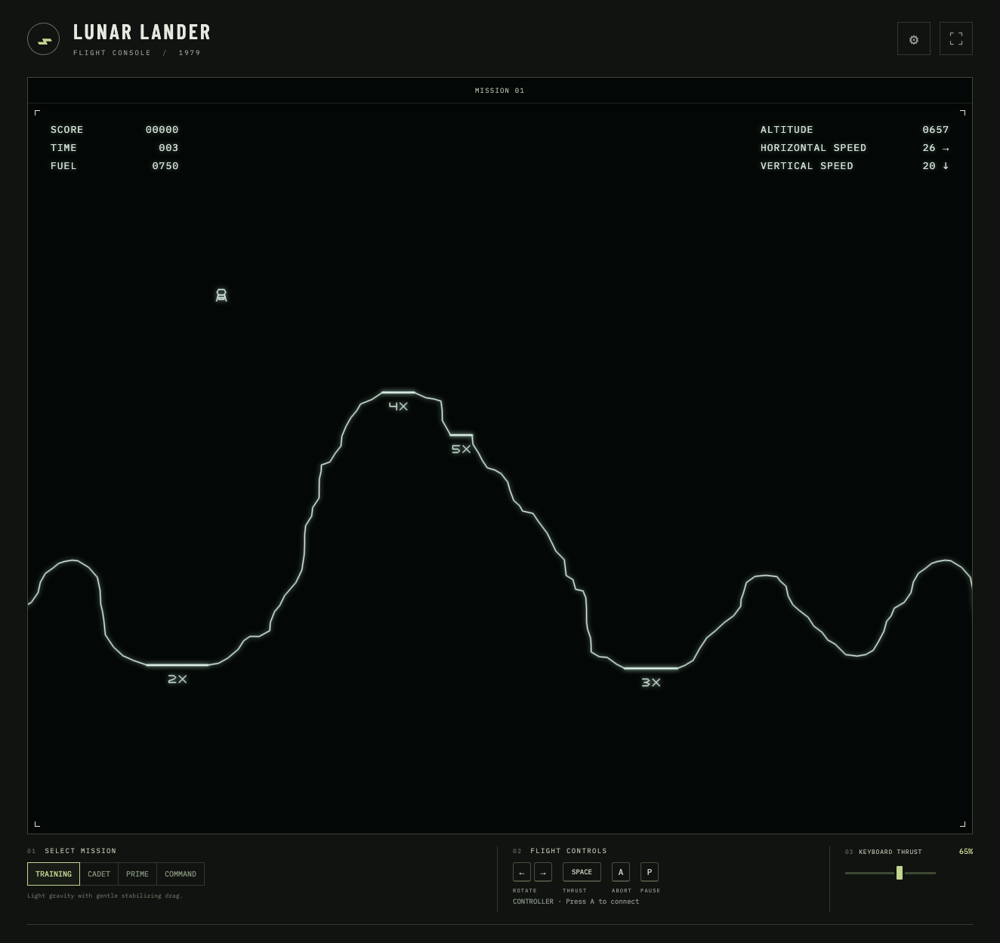

# Lunar Lander

A little arcade adventure, a long way from Earth. Guide your lander onto the lunar surface before your fuel runs out.

**[Play Lunar Lander](https://dpellerin.github.io/lunar-lander/)**

Every round brings a new rocky landscape. Choose from four difficulty levels, aim for the landing pads, and chase a higher score. Classic vector lines, glowing graphics and arcade sounds complete the trip.

## How to play

| Action              | Keyboard | Xbox controller    |
| ------------------- | -------- | ------------------ |
| Launch / next round | Enter    | A                  |
| Rotate              | ← / →    | Left stick / D-pad |
| Thrust              | Space    | Right trigger      |
| Emergency abort     | A        | B                  |
| Pause / resume      | P / Esc  | Menu               |
| Preferences         | ?        | Y                  |

For an Xbox controller, pair it with your device, then press any button to connect. Release it and press **A** to launch. Squeeze the right trigger to control your thrust.

Touch controls are available on smaller screens. Open **Preferences** for vector glow, the full controls table and scoring. Sound is always enabled. **Click for Sound** on the splash screen unlocks audio before you launch with a controller.

## Scoring

- **Soft landing:** 50 points × the pad bonus, plus 50 fuel.
- **Hard landing:** 15 points × the pad bonus.
- **Crash:** 5 points. Keep trying while you have fuel!

An independent tribute to the 1979 arcade classic.

Want to tinker? See the [development notes](docs/DEVELOPMENT.md).
